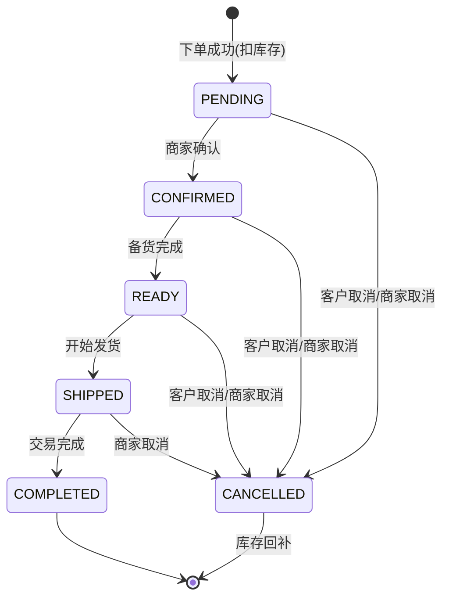

# 订单状态流转 · 口径裁定（迭代 3 · 挑战需求 B.1）

> 一页把「状态怎么走、谁能动、哪些会报错」讲清，并把澄清问答里的矛盾点逐条裁定。
> 用途：接口契约（第 3 份）、表结构（第 4 份）、前端（童昕祺 / 陈泽英）都以此为准。

## 一、状态枚举

| 码值 | 状态 | 中文 | 进入方式 | 是否终态 |
|---|---|---|---|---|
| 10 | PENDING | 客户下单 | 下单成功时创建 | 否 |
| 20 | CONFIRMED | 商家确认 | 商家操作 | 否 |
| 30 | READY | 备货完成 | 商家操作 | 否 |
| 40 | SHIPPED | 开始发货 | 商家操作 | 否 |
| 50 | COMPLETED | 交易完成 | 商家操作 | **是** |
| 90 | CANCELLED | 已取消 | 客户或商家操作 | **是** |

> 用 10 的倍数而非 1~5，为后续插态留空间；对外展示顺序仍是五个业务态 + 已取消。

## 二、状态机

合法流转只有 8 条：4 条正向 + 4 条取消。其余全部非法。

## 三、合法流转矩阵

| 当前状态 → 目标 | 客户可操作 | 商家可操作 |
|---|---|---|
| 10 → 20 商家确认 | — | 允许 |
| 20 → 30 备货完成 | — | 允许 |
| 30 → 40 开始发货 | — | 允许 |
| 40 → 50 交易完成 | — | 允许 |
| 10 / 20 / 30 → 90 取消 | 允许 | 允许 |
| 40 → 90 取消 | 不允许 | 允许 |
| 50 / 90 → 任意 | 不允许 | 不允许 |

## 四、非法操作与错误码

| 场景 | 码 | 说明 |
|---|---|---|
| 跳态（如 20 → 40） | 40921 | 附「当前状态 / 目标状态」 |
| 重复提交同一状态 | 40921 | 不做幂等静默成功 |
| 回退（如 20 → 10） | 40921 | 不支持任何回退 |
| 客户在 40 取消 | 40921 | 时机已过 |
| 任何人在 50 / 90 操作 | 40923 | 终态不可变 |
| 非订单归属客户 / 非卖家 | 40922 | 越权 |
| 订单号不存在 | 40927 | — |

> 40921 ~ 40927 是 B 新增段，与迭代 2 使用的 40901 ~ 40917 不冲突。

## 五、口径裁定（澄清问答中的矛盾）

问答里同一个人在不同轮次给了相反答案，必须裁定，否则代码写完会被推翻。

### 裁定 1 · 库存扣减时点：**下单即扣，取消回补**

| 出现的说法 | 出处 | 采用 |
|---|---|---|
| 下单不扣、成交才扣；取消回补 +1 | 早期答复（王韵童） | 否 |
| 无预占，取消不影响库存，成交才扣 | 中期纠正（周航宇） | 否 |
| **下单就真实扣减，占用锁死可售；取消把库存加回** | 最新针对 B 的明确答复（周育民） | **是** |

理由：
1. 最新答复明确「真的扣，不是只挂个名」，并确认「已有订单在下单时就已经扣掉了」；
2. 只有下单即扣，才能满足老师反复强调的两条硬约束——库存不能为负 + 不允许超卖；
3. 「成交才扣」会让多笔在途订单争最后一件库存，问答中对此的处置始终是「需求没写、你们补」，说明该模型本身有缺口。

推论（必须同步到实现与前端）：
- 取消一定有库存回补，回补量 = 明细数量；
- 成交时**不再扣库存**，否则重复扣减；
- 「成交时库存不足」场景消失，只需下单时校验；
- 下单扣到 0 → 商品立即自动下架（不等成交）。

### 裁定 2 · 排队 / 冻结机制：**在 B 中下线**

| 说法 | 采用 |
|---|---|
| 「意向、排队、冻结原样保留，一个都没废」 | 否 |
| 「有购物车和订单之后，先到先得排队自然不存在」「冻结态没了」 | **是** |

理由：一个订单模型里不能同时存在两套占货逻辑——排队不占库存、下单占库存，二者对同一件库存给出不同答案。且商品状态若保留「交易中冻结」，订单流转中商品何时冻结无定义。故商品状态收敛为在售 / 已下架（见 B.1-5）。

### 裁定 3 · 有在途订单时能否调库存 / 下架：**允许**

| 说法 | 采用 |
|---|---|
| 「有非终态订单就不允许改库存为 0 或手动下架」（保守做法） | 否 |
| 「已有订单保留待完成，调库存只把剩余可售归零，不动在途订单」 | **是** |

理由：后者以下单即扣为前提，逻辑自洽；前者是「成交才扣」模型下的补丁，裁定 1 已否掉该前提。

### 裁定 4 · 多件下单部分缺货：**整单拒绝 + 返回缺货清单**

【已裁定】不是整单拒绝、不是部分成单，而是「提示缺货、客户剔除后重下」。落地上等价于：本次请求整体不生成订单，响应带缺货明细。不做「只生成 A 的部分订单」，避免一单金额与状态割裂。

### 裁定 5 · 已取消是否独立状态：**独立**（码值 90）

【已裁定】不与交易完成共用；已取消是终态，不可再推进。已取消订单计入买家下单历史，标「已取消」。不记录取消原因与取消时间。

## 六、与迭代 2 实现的差异（改造点）

| 项 | 迭代 2（A） | 迭代 3（B） | 影响 |
|---|---|---|---|
| 交易载体 | 意向 + 队列 + 交易冻结 | 订单 + 5 态流转 | 新增 order / order_item |
| 库存扣减 | 标记交易成功时减 1 | 下单即扣，取消回补 | 扣减点前移 |
| 商品状态 | 4 态（含冻结） | 2 态 | 枚举收敛 |
| 单笔数量 | 固定 1 件 | 支持多件（明细带数量） | 结构变化 |
| 取消 | 不存在 | 双向取消 + 回补 | 新增 |
| 成交下架 | 永久不可复售 | 可复售：取消回补自动在售；商家主动补货需手动上架 | 逻辑变化 |

> 这 6 项里有 3 项（库存扣减点、商品状态收敛、复售规则）不在禅道 B1-1 ~ B1-6 任务范围内，属跨任务改造，需与组长确认工时，详见《挑战需求B_数据模型与任务缺口》第四节。

<!-- END -->
