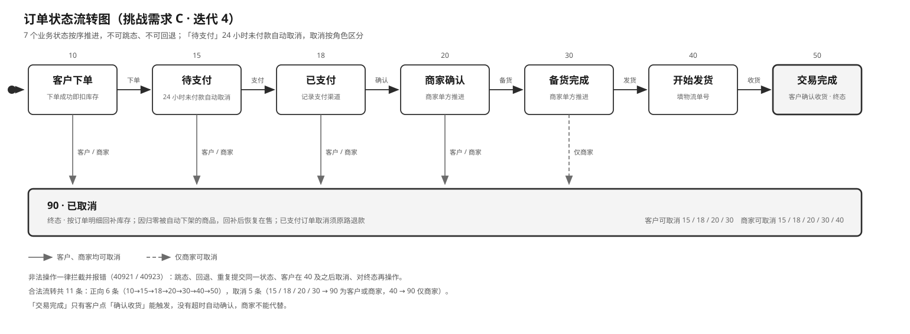
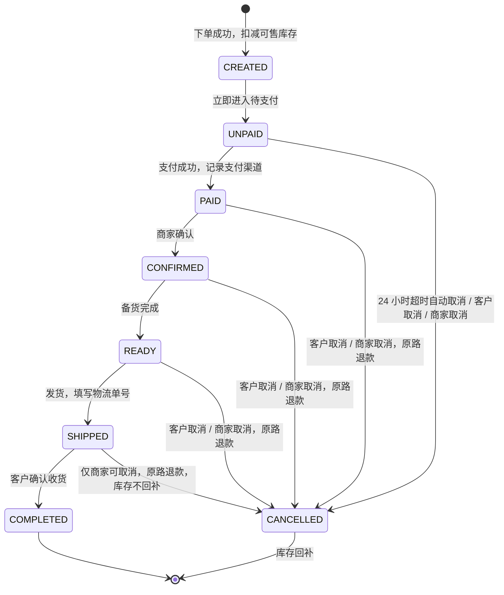

# 订单状态流转图（挑战需求 C · 迭代 4）

> 本文件只含状态流转图与状态规则，独立可读。
> 图有两个版本：`订单状态流转图-挑战需求C.svg`（矢量图，可直接插 Word / PPT / 浏览器打开）、下方 mermaid 源码（贴 Wiki、禅道用）。



## 一、Mermaid 源码版



## 二、文字版（渲染失败时看这个）

```
      ● ──►┌──────────┐  ┌──────────┐  ┌──────────┐  ┌──────────┐  ┌──────────┐  ┌──────────┐  ┌──────────┐
           │ 客户下单 │─►│  待支付  │─►│  已支付  │─►│ 商家确认 │─►│ 备货完成 │─►│ 开始发货 │─►│ 交易完成 │
           │    10    │  │    15    │  │    18    │  │    20    │  │    30    │  │    40    │  │    50    │
           └────┬─────┘  └────┬─────┘  └────┬─────┘  └────┬─────┘  └────┬─────┘  └────┬─────┘  └──────────┘
                │             │             │             │             │             │            终态
                │        ┌────┴─────────────┴─────────────┴─────────────┴─────────────┘
                │        │  客户可取消：15 / 18 / 20 / 30
                │        │  商家可取消：15 / 18 / 20 / 30 / 40
                │        │
                │   ┌────▼─────┐
                └──►│  已取消  │  90
                    │ 回补库存 │  终态
                    └──────────┘
```

## 三、状态表

| 码值 | 状态 | 谁推进 | 是否终态 | 库存动作 |
|---|---|---|---|---|
| 10 | 客户下单 | 客户提交订单时自动创建 | 否 | 扣减可售库存 |
| 15 | 待支付 | 下单后自动进入，等待客户支付 | 否 | 不重复扣减 |
| 18 | 已支付 | 支付成功回调 | 否 | 不重复扣减 |
| 20 | 商家确认 | 商家 | 否 | 不动 |
| 30 | 备货完成 | 商家 | 否 | 不动 |
| 40 | 开始发货 | 商家，须填物流单号 | 否 | 不动 |
| 50 | 交易完成 | 客户点「确认收货」 | 是 | 不动 |
| 90 | 已取消 | 客户或商家，或系统超时 | 是 | 按明细回补 |

## 四、流转规则

合法流转共 11 条边，其余全部非法：

**正向 6 条**

1. 10 → 15 下单后立即进入待支付（自动，无人工操作）
2. 15 → 18 支付成功
3. 18 → 20 商家确认
4. 20 → 30 备货完成
5. 30 → 40 发货，必须填物流单号与快递公司
6. 40 → 50 客户点「确认收货」，是 50 的唯一入口

**取消 5 条**

7. 15 → 90 三种触发：24 小时超时自动取消（系统）、客户取消、商家取消；均不产生退款，回补库存
8. 18 → 90 客户取消或商家取消，原路退款，回补库存
9. 20 → 90 客户取消或商家取消，原路退款，回补库存
10. 30 → 90 客户取消或商家取消，原路退款，回补库存
11. 40 → 90 **仅商家**可取消，原路退款，**库存不回补**（货已发出）

必须拦截的非法操作：

- 跳态：如 18 直接到 30
- 回退：如 20 退回 18
- 重复提交同一状态
- 客户在 40 及之后取消（40921）
- 未支付（15）直接确认、备货、发货
- 商家代替客户把 40 置为 50
- 对 50、90 终态再做任何操作（40923）

## 五、库存联动

库存按「下单扣减、取消回补、完成不动」处理，与迭代 3 的实现保持一致，避免出现「预占」与「成交才扣」两套机制并存：

| 时点 | 动作 |
|---|---|
| 10 创建订单 | 按明细逐条扣减可售库存；任一商品不足则整单不生成（40924）；扣到 0 自动下架该商品 |
| 15 → 18 支付成功 | 不再动库存（10 已扣） |
| 15 / 18 / 20 / 30 → 90 | 按明细逐条回补库存；回补后库存 > 0 且因归零下架的，自动恢复在售 |
| 40 → 90 商家取消 | 不回补库存（商品已发出），由售后流程另行处理 |
| 40 → 50 交易完成 | 不再动库存（下单时已扣，重复扣会错） |

## 六、与迭代 3（挑战 B）的差异

| 项 | 迭代 3 | 迭代 4（本图） |
|---|---|---|
| 状态数 | 6 个（5 业务态 + 已取消） | 8 个（7 业务态 + 已取消） |
| 新增状态 | — | 15 待支付、18 已支付 |
| 状态码兼容 | 10 / 20 / 30 / 40 / 50 / 90 | 保留原码值，仅插入 15、18，不改动其余码值 |
| 交易完成触发 | 商家点「完成」 | 客户点「确认收货」，商家无权限 |
| 取消退款 | 不涉及 | 18 及之后取消须原路退款 |
| 支付超时 | 无 | 15 停留 24 小时自动取消 |
| 发货要求 | 无物流信息 | 必须填物流单号与快递公司 |

> 状态码沿用 10 / 20 / 30 / 40 / 50 / 90，只在 10 与 20 之间插入 15、18，存量数据与已有判断逻辑不需要改码值。
