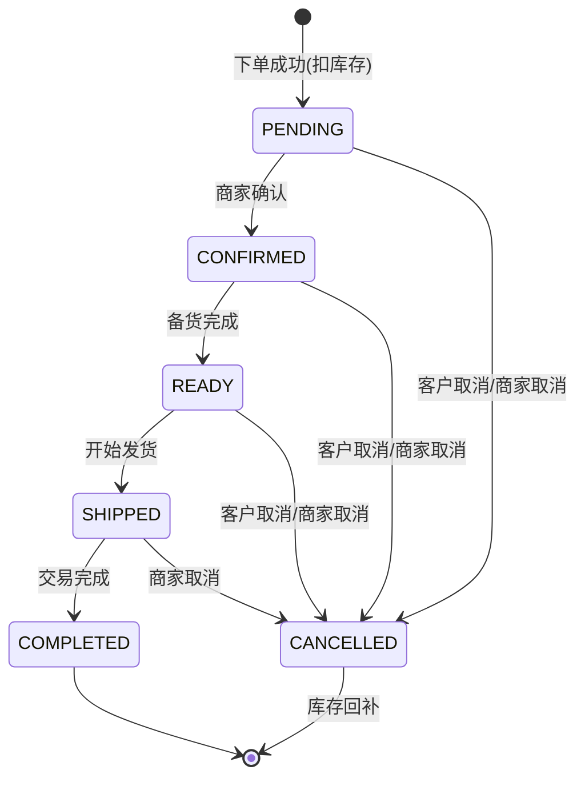

# 订单状态流转图（挑战需求 B · B.1）

> 本文件只含状态流转图与状态规则，独立可读。
> 图有两个版本：`挑战需求B_订单状态流转图.svg`（矢量图，可直接插 Word / PPT / 浏览器打开）、下方 mermaid 源码（贴 Wiki、禅道用）。


## 一、Mermaid 源码版



## 二、文字版（渲染失败时看这个）

```
                      ┌──────────┐    ┌──────────┐    ┌──────────┐    ┌──────────┐    ┌──────────┐
       ● ────────────►│ 客户下单 │───►│ 商家确认 │───►│ 备货完成 │───►│ 开始发货 │───►│ 交易完成 │
                      │    10    │    │    20    │    │    30    │    │    40    │    │    50    │
                      └────┬─────┘    └────┬─────┘    └────┬─────┘    └────┬─────┘    └──────────┘
                           │               │               │               │             终态
                           └───────────────┴───────────────┴───────────────┘
                                           客户可取消：10 / 20 / 30
                                           商家可取消：10 / 20 / 30 / 40
                                                           │
                                                      ┌────▼─────┐
                                                      │  已取消  │  90
                                                      │ 回补库存 │  终态
                                                      └──────────┘
```

## 三、状态表

| 码值 | 状态 | 谁推进 | 是否终态 |
|---|---|---|---|
| 10 | 客户下单 | 客户下单自动创建 | 否 |
| 20 | 商家确认 | 商家 | 否 |
| 30 | 备货完成 | 商家 | 否 |
| 40 | 开始发货 | 商家 | 否 |
| 50 | 交易完成 | 商家 | 是 |
| 90 | 已取消 | 客户或商家 | 是 |

## 四、流转规则

合法流转共 8 条，其余全部非法：

1. 10 → 20 商家确认
2. 20 → 30 备货完成
3. 30 → 40 开始发货
4. 40 → 50 交易完成
5. 10 → 90 取消（客户、商家均可）
6. 20 → 90 取消（客户、商家均可）
7. 30 → 90 取消（客户、商家均可）
8. 40 → 90 取消（**仅商家**）

必须拦截的非法操作：

- 跳态：如 20 直接到 40
- 回退：如 20 退回 10
- 重复提交同一状态
- 客户在 40 取消
- 对 50、90 的终态再做任何操作

## 五、库存联动

| 时点 | 动作 |
|---|---|
| 10 创建 | 按明细逐条扣减库存，扣到 0 自动下架该商品 |
| 90 取消 | 按明细逐条回补库存，回补后库存 > 0 且因归零下架的，恢复在售 |
| 50 完成 | **不再动库存**（下单时已扣，重复扣会错） |
